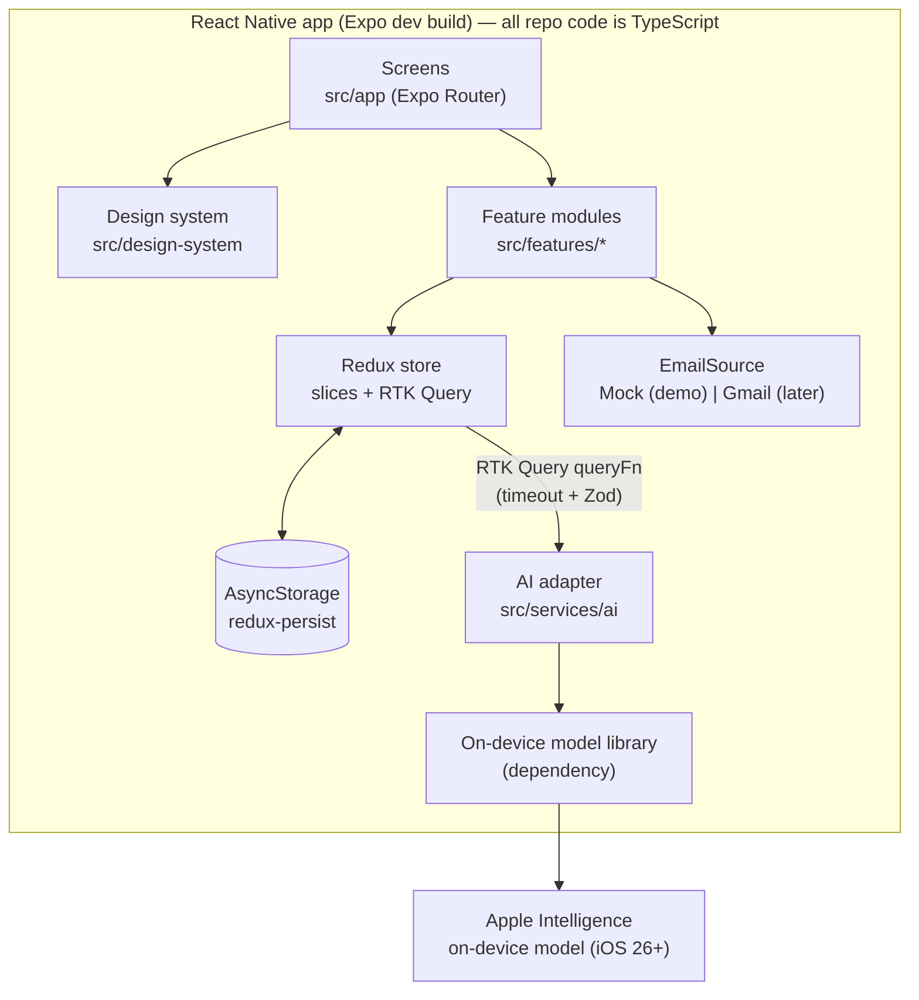

# Architecture

The architecture is organized around the four requirements in the project brief. Each section below names the requirement it serves.



## Requirement 1 — React Native & TypeScript

### Platform

- **Expo SDK 58, dev build** (not Expo Go). Required by the `expo-sharing` share-receive plugin ([ADR 0001](adr/0001-official-expo-sharing-for-share-intake.md)).
- **Expo Router** with typed routes. Route files stay thin: they read params, call a feature hook, and render feature components.
- **New Architecture** (Expo default).
- Targets: iOS Simulator and Android Emulator for the demo. Web is out of scope.
- **AI is iOS-only** (Apple Intelligence). Android runs every non-AI feature, with AI gated off. See [ADR 0005](adr/0005-on-device-apple-foundation-models.md).

### TypeScript rules

`tsconfig.json` extends `expo/tsconfig.base` and adds:

| Flag | Why |
|---|---|
| `strict: true` | Baseline |
| `noUncheckedIndexedAccess: true` | Record and array lookups return `T \| undefined`; forces handling missing entities |
| `exactOptionalPropertyTypes: true` | `salary?: Salary` can't be set to `undefined` by accident |
| `noImplicitOverride`, `noFallthroughCasesInSwitch` | Fewer silent bugs |

Code rules (enforced by ESLint where possible):

1. No `any`. `unknown` + Zod parse at boundaries.
2. No non-null assertions (`!`) outside tests.
3. Exhaustive `switch` over unions with a `never` check helper (`assertNever`).
4. Domain types are inferred from Zod schemas (`z.infer`), so runtime validation and static types can't drift.
5. IDs are branded types (`ApplicationId`, `MessageId`) so an application ID can't be passed where a message ID is expected.

## Requirement 2 — Code quality

### Folder layout (feature-first)

```
src/
  app/                          # Expo Router routes (thin)
    _layout.tsx                 # providers: Redux, PersistGate, Theme, ErrorBoundary
    +native-intent.ts           # redirect incoming shares to /intake/share
    (tabs)/
      _layout.tsx
      index.tsx                 # Pipeline
      inbox.tsx                 # Inbox
      prep.tsx                  # Prep hub
    application/new.tsx         # Manual add (accepts prefill params)
    application/[id]/index.tsx  # Application detail
    application/[id]/edit.tsx
    intake/new.tsx              # Paste URL or text
    intake/share.tsx            # Share-received handler
    intake/review/[draftId].tsx # Confirm AI draft
    prep/[applicationId]/index.tsx, mock.tsx, reviews.tsx, session/[sessionId].tsx
    inbox/[messageId].tsx, inbox/connect-gmail.tsx
    settings.tsx
    dev/design-system.tsx, dev/ai-spike.tsx   # __DEV__ only
  design-system/                # see docs/design-system.md
  features/
    applications/  { schema.ts, slice.ts, selectors.ts, demoSeed.ts, components/ }
    capabilities/  { slice.ts, useAiAvailabilitySync.ts }
    intake/        { schema.ts, draftsSlice.ts, fetchListing.ts, AI task + prompt, components/ }
    inbox/         { schema.ts, emailSource.ts, mock + Gmail sources, fixtures/, slice.ts, AI task + prompt, components/ }
    prep/          { schema.ts, slice.ts, AI tasks + prompts, components/ }
    settings/      { slice.ts }
  services/
    ai/            { model.ts (adapter interface), foundationModels.ios.ts (library), foundationModels.ts (non-iOS stub),
                     errorMapping.ts, withTimeout.ts, budget.ts, aiApi.ts (RTK Query base) }
  store/           { store.ts, hooks.ts }
  lib/             { errors.ts, result.ts, assertNever.ts, ids.ts, dates.ts, stage.ts }
  test/            { renderWithProviders.tsx }
```

Rules:

1. A feature can import from `design-system`, `lib`, `services`, `store/hooks`, and its own folder. Features don't import each other's internals; they share through selectors exported from a feature's `index.ts`.
2. Only `src/services/ai/foundationModels.ios.ts` imports the on-device model library. An ESLint `no-restricted-imports` rule blocks it everywhere else, so swapping libraries touches one file. Metro picks the `.ios.ts` file on iOS; every other platform gets `foundationModels.ts`, which always reports AI as unavailable, so the native library never loads on Android.
3. Components receive data through props. Hooks (`useApplication(id)`) connect components to the store.

### Error handling

All failures become one typed union. Screens never see raw exceptions.

```ts
// src/lib/errors.ts
export type AppError =
  | { kind: 'network' }                                   // offline, DNS, connection reset (URL fetch only)
  | { kind: 'timeout'; afterMs: number }                  // request took longer than its limit
  | { kind: 'invalid_response'; issues: string[] }        // Zod parse failed
  | { kind: 'ai_unavailable'; reason: AiUnavailableReason }
  | { kind: 'context_too_long' }                          // input didn't fit the model's context window
  | { kind: 'content_blocked' }                           // model safety guardrail refused the request
  | { kind: 'ai_failed'; code: string }                   // any other model failure, code kept for diagnosis
  | { kind: 'listing_unreadable'; reason: 'blocked' | 'empty' | 'login_wall' | 'non_html' }
  | { kind: 'not_found'; entity: 'application' | 'draft' | 'message' };

export type AiUnavailableReason =
  | 'unsupported_platform'             // Android
  | 'os_too_old'                       // iOS < 26
  | 'apple_intelligence_unavailable';  // ineligible device, turned off, or still downloading
```

The provider reports availability as a boolean, so the three iPhone-side causes share one reason, with copy that points to Settings → Apple Intelligence & Siri.

| Layer | Responsibility |
|---|---|
| `services/ai/foundationModels.ios.ts` + `errorMapping.ts` | Map provider and AI SDK errors to `AppError` (the provider forwards Foundation Models errors as text, so context and guardrail errors are matched by message); Zod-parse every result even though the provider already applies the schema |
| `services/ai/withTimeout.ts` | Per-task time limits; a late native result is ignored |
| `features/intake/fetchListing.ts` | URL fetch with a 10 s timeout; maps failures to `network` or `listing_unreadable` |
| Slices | Store `AppError` in state where the UI needs it (e.g. a message's triage status) |
| Components | `ErrorState` maps `kind` to plain-language copy and a retry action |
| Root | `ErrorBoundary` in `_layout.tsx` catches render errors, shows a recover screen, and logs in dev |
| Forms | Zod schemas validate manual entry; field errors render through `TextField.error` |

**AI failure never blocks core application tracking.** If extraction fails, the user fills the form by hand. If triage fails, the user tags the message by hand. Prep questions and mock interviews have no manual equivalent; on failure they keep existing state (question set, transcript, typed answer) and offer retry.

## Requirement 3 — Redux (Redux Toolkit)

### Store shape

```ts
interface RootState {
  applications: EntityState<Application, ApplicationId>; // createEntityAdapter, sorted by updatedAt
  drafts: EntityState<ApplicationDraft, DraftId>;          // AI output awaiting user confirmation
  inbox: {
    messages: EntityState<InboxMessage, MessageId>;
    triage: Record<MessageId, TriageState>;               // idle | pending | done(result) | failed(AppError)
    fixtureCursor: number;                                // next mock message to "receive"
    updates: Record<MessageId, EmailUpdate>;              // what confident Triage applied by itself; the log + Undo (ADR 0007)
    acknowledgedTimeoutAt: number | null;                 // "Analyze remaining" un-pauses Triage after a time-out
  };
  prep: {
    questionSets: Record<ApplicationId, PrepQuestionSet>;
    sessions: EntityState<MockInterviewSession, SessionId>;
  };
  settings: { theme: ThemePreference; emailSource: 'mock'; aiReplay: boolean };
  capabilities: { ai: AiAvailability };                   // not persisted; re-checked at launch and on app foreground
  aiApi: /* RTK Query cache */;
}
```

### Why this shape

- **Entity adapters** for anything listed or looked up by ID: O(1) lookups, ready-made CRUD reducers, normalized state.
- **Drafts are a separate slice.** AI output never writes straight into `applications`. The user confirms a draft, which dispatches `applicationAdded` and `draftRemoved`. This is the human-in-the-loop boundary in code. The one exception is a confident Triage, which applies its Stage change and Next Step itself and records an `EmailUpdate` that can be undone ([ADR 0007](adr/0007-auto-apply-confident-email-updates.md)).
- **Triage state lives next to messages**, keyed by ID, so one failed message doesn't affect others.
- **RTK Query** owns request lifecycle (loading, error, dedupe) for AI calls. Its results are copied into domain slices on success via `extraReducers` or `onQueryStarted`, so domain data persists even though the RTK Query cache doesn't.

### Selectors

Memoized with `createSelector`, colocated in each feature's `selectors.ts`, and unit-tested:

| Selector | Returns |
|---|---|
| `selectApplicationsByStage` | `Record<Stage, Application[]>` for the pipeline board |
| `selectUpcomingNextSteps` | Next steps sorted by due date, flagged `urgent` within 48 h |
| `selectPipelineCounts` | Counts per stage for the header summary |
| `selectUntriagedMessages` | Inbox messages with no triage result |
| `selectAiAvailability` | `capabilities.ai`, read by every AI entry point |
| `selectPrepProgress(applicationId)` | Answered / total prep questions |

### Persistence

`redux-persist` with AsyncStorage. Persisted: `applications`, `drafts`, `inbox`, `prep`, `settings`. Not persisted: `capabilities` (the user can turn Apple Intelligence on or off at any time) and `aiApi` (request cache). Each persisted slice has a `version` and a `migrate` function from the first release onward.

### Typed hooks

`store/hooks.ts` exports `useAppDispatch` and `useAppSelector` (`.withTypes<>()`). Untyped `useDispatch`/`useSelector` are banned by ESLint.

## AI features (product)

### On-device model

AI runs on Apple's on-device foundation model through a third-party React Native library, wrapped by one adapter ([ADR 0005](adr/0005-on-device-apple-foundation-models.md)). No server, no API key, no metered per-token cost, and listing and email text never leave the device. Tokens still matter: see [Context budget](#context-budget).

```ts
// src/services/ai/model.ts
export type AiAvailability =
  | { status: 'available'; contextTokens: number }
  | { status: 'unavailable'; reason: AiUnavailableReason };

export interface OnDeviceModel {
  availability(): AiAvailability;
  generate<S extends z.ZodType>(request: {
    instructions: string;
    prompt: string;
    schema: S;
  }): Promise<Result<z.infer<S>, AppError>>;
}
```

- `foundationModels.ios.ts` implements `OnDeviceModel` with `@react-native-ai/apple` + `ai@6` (`generateText` with `Output.object`), which passed the [spike gate](adr/0005-on-device-apple-foundation-models.md#spike-result-2026-11-05).
- `foundationModels.ts` implements it for every non-iOS platform; every call returns `ai_unavailable`.
- Jest tests use a fake `OnDeviceModel`. The library is never loaded in tests.

### Tasks

Each task lives in its feature folder with its own prompt, Zod output schema, and time limit, and is exposed through `aiApi.injectEndpoints` with a `queryFn`.

| Task | Input | Output (Zod schema) | Time limit |
|---|---|---|---|
| `extractListing` | listing text | `ListingExtraction` → becomes an `ApplicationDraft` | 20 s |
| `triageMessage` | `{ message, applications: { id, company, role }[] }` | `TriageResult`: category, matched application ID or none, proposed next step, confidence | 20 s |
| `prepQuestions` | application summary | `PrepQuestionSet`: questions grouped by type (behavioral, technical, role-specific, questions to ask) | 45 s |
| `mockInterviewTurn` | application summary, current question, answer, earlier question titles | `MockInterviewTurn`: feedback on the answer + next question | 45 s |

Time limits are starting values. Measured on the iOS 27 Simulator (M4 host): listing extraction 5.3–6.3 s.

### Context budget

The on-device model has a small context window (8,192 tokens measured on macOS 27; Apple documents 4,096). Rules:

1. **One fresh session per request.** No long-lived chat sessions, so context never accumulates.
2. **Budget for 4,096 tokens** regardless of the measured size, so the app behaves the same on every supported OS.
3. **Trim listings before sending.** `budget.ts` strips boilerplate (navigation, legal footers, repeated whitespace) and, if still too long, keeps the beginning, where company and role usually appear. The draft review shows "Only the first part of this listing was read" when trimming happened.
4. **Mock interviews send a summary, not the transcript.** Each turn sends the application summary, the current question and answer, and the titles of earlier questions (to avoid repeats). The full transcript stays in Redux.
5. **`context_too_long` is still handled** in case an estimate is wrong: intake offers manual entry; other tasks offer retry with shorter input.

### Availability

`capabilities.ai` is filled at launch and re-checked when the app returns to the foreground. AI entry points read it through `selectAiAvailability`:

- **Available:** AI actions are shown normally.
- **Unavailable:** intake opens the manual form, inbox shows "Tag manually", and prep and mock interview show why AI is unavailable and what to do (e.g. "Turn on Apple Intelligence in Settings"). See [UX-7](user-stories.md#ux-7--know-when-ai-isnt-available-).

### Listing fetch

URL intake fetches the page on the device, strips it to text, and checks the result before calling the model. Blocked, empty, login-wall, or JavaScript-only pages return `listing_unreadable`, and the app asks the user to paste the listing text. **Pasted text is the primary path for every job board**; URL fetch is a shortcut that may fail on any site. URL fetch is the only AI-adjacent step that needs a network.

### Guardrails

1. Structured output only. The provider constrains output to the task's Zod schema, and the adapter validates it again with Zod.
2. **Flat output schemas.** Model output schemas use only top-level strings, string enums, numbers, and arrays of strings; code maps them to nested domain types. In the 2026-11-05 model checks, the only two requests that timed out were the two whose output schemas had nested objects; every flat schema finished in 1–7 s. The provider gives nested objects unnamed sub-schemas, which is the suspected cause, not a proven one.
3. Triage receives only the user's existing applications as match candidates and must return one of those IDs or `none`. It can't invent applications.
4. **Every request declares its output.** `GenerateRequest` requires `maxOutputTokens` and `sampling`. `repeatable` (temperature 0) for extraction, triage, and review questions; `varied` (temperature 0.7) for prep and mock-interview questions, so a retry gives new questions.

   | Task | `maxOutputTokens` | Sampling | Measured (2026-11-05, iOS 27 Simulator) |
   |---|---|---|---|
   | Listing extraction | 400 | repeatable | 1.3–4.2 s |
   | Email triage | 200 | repeatable | 0.9–5.6 s |
   | Prep questions | 900 | varied | 9.7 s |
   | First mock question | 120 | varied | 1.1 s |
   | Mock-interview turn | 600 | varied | 4.5 s |
   | Review questions | 300 | repeatable | not timed |
5. **One native generation at a time.** A request that times out keeps running natively; without the queue, it blocked every request behind it. The adapter chains native calls (`nativeQueue`), and the time limit includes time spent waiting in the queue.
6. **Small-model compensation, in code, not prompts alone.** Extraction keeps company, location, salary, and role only when they appear in the listing; triage matches an application only when the email names its company, fills a default Next Step title for action categories, and never proposes a step for a rejection. String limits are enforced in code, not in the model schema, because one violation fails the whole response. All unit-tested.
7. Per-task time limit and a Retry action. Intake and triage also offer the manual path; prep and mock interview keep state for retry.
8. **AI replay** (`settings.aiReplay`, dev only): replays recorded triage results for the sample inbox. The UI shows a "Replayed" badge on any replayed result. It is a demo safety net, never presented as live output.
9. **Confident email updates apply themselves, with Undo** ([ADR 0007](adr/0007-auto-apply-confident-email-updates.md)). Only when Triage returns `confidence: 'high'` and a matched application that is one of the candidates, still exists, and is still open. The model classifies the email; `stageFromTriage` maps that category to a bounded Stage change in code: only forward moves, except a rejection. Rejected or Withdrawn applications are never changed by email; those messages stay proposals. Each change is recorded as an `EmailUpdate` (`inbox.updates`); Undo reverts only what is still as the email left it (the Stage, if unchanged since; the Next Step, if it still exists and isn't done). Low-confidence and unmatched results stay proposals.

## Inbox

```ts
// src/features/inbox/emailSource.ts
export interface EmailSource {
  listRecent(since: string): Promise<InboxMessage[]>;
}
```

The demo uses `MockEmailSource`, backed by `fixtures/inbox.json` (about 8 messages: interview invite, scheduling link, take-home, rejection, offer, recruiter follow-up, newsletter, receipt). A dev-only "Receive next email" action appends the next fixture so the app can react live. `GmailEmailSource` reads a connected Gmail inbox behind the same interface. See [ADR 0002](adr/0002-mock-email-source-behind-interface.md).

Reading is app-wide: the root layout mounts `useEmailReading`, which runs the one-at-a-time Triage queue (so new messages are triaged and confident updates applied on any screen) and, while a Gmail token exists, reads Gmail when the token arrives and when the app returns to the foreground. The Inbox tab also reads Gmail when it is focused and on pull-to-refresh. There are no polling timers (INBX-8). The Gmail token is kept in memory only, so after a relaunch the user signs in again before Gmail is read.

## Requirement 4 — AI in development

How AI is used to build the app (separate from AI features in the product) is in [`docs/ai-development.md`](ai-development.md) and enforced by [`AGENTS.md`](../AGENTS.md).

## Testing

| Level | Tool | What |
|---|---|---|
| Unit | Jest (`jest-expo`) | Zod schemas (accept/reject real-shaped payloads), reducers, selectors, triage matching, adapter error mapping, `budget.ts` trimming |
| Component | React Native Testing Library | Design-system components by role/label: disabled, loading, error copy, required labels |
| Screen | RNTL + fake `OnDeviceModel` | Intake flow: paste → draft → confirm → appears in pipeline; failure → manual form; AI unavailable → manual form |
| Manual | Simulator + Emulator | On-device AI on the iOS Simulator; AI gated off on Android; share-sheet intake, theme switch, font scaling, VoiceOver/TalkBack pass |

CI runners have no Apple Intelligence, so CI never calls the real model. Prompt quality is checked by hand against a fixed set of sample listings and emails (tier 2 and 4).

CI (GitHub Actions): `tsc --noEmit`, ESLint, Jest on every push.
