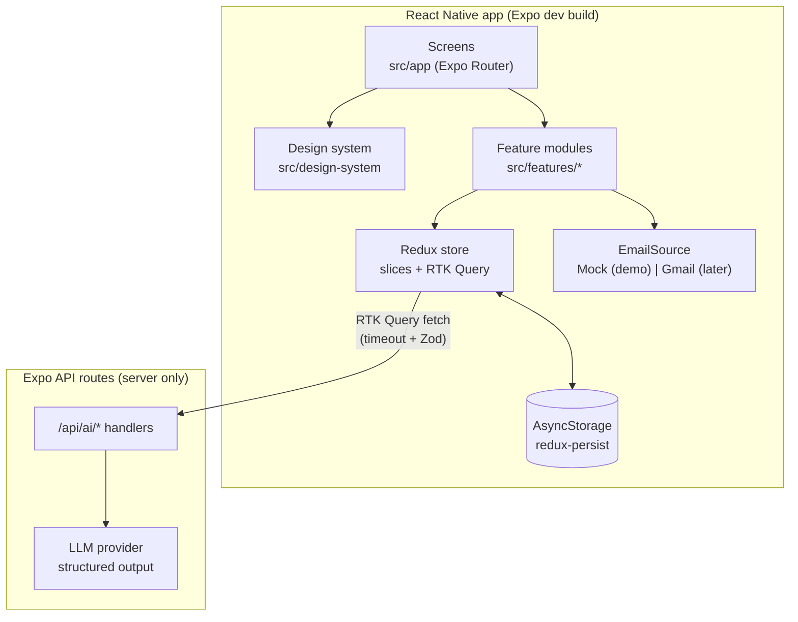

# Architecture

The architecture is organized around the four requirements in the project brief. Each section below names the requirement it serves.



## Requirement 1 — React Native & TypeScript

### Platform

- **Expo SDK 58, dev build** (not Expo Go). Required by the `expo-sharing` share-receive plugin ([ADR 0001](adr/0001-official-expo-sharing-for-share-intake.md)).
- **Expo Router** with typed routes. Route files stay thin: they read params, call a feature hook, and render feature components.
- **New Architecture** (Expo default).
- Targets: iOS Simulator and Android Emulator for the demo. Web is out of scope.

### TypeScript rules

`tsconfig.json` extends `expo/tsconfig.base` and adds:

| Flag | Why |
|---|---|
| `strict: true` | Baseline |
| `noUncheckedIndexedAccess: true` | Record and array lookups return `T \| undefined`; forces handling missing entities |
| `exactOptionalPropertyTypes: true` | `salary?: Salary` can't be set to `undefined` by accident |
| `noImplicitOverride`, `noFallthroughCasesInSwitch` | Fewer silent bugs |

Code rules (enforced by ESLint where possible):

1. No `any`. `unknown` + Zod parse at boundaries.
2. No non-null assertions (`!`) outside tests.
3. Exhaustive `switch` over unions with a `never` check helper (`assertNever`).
4. Domain types are inferred from Zod schemas (`z.infer`), so runtime validation and static types can't drift.
5. IDs are branded types (`ApplicationId`, `MessageId`) so an application ID can't be passed where a message ID is expected.

## Requirement 2 — Code quality

### Folder layout (feature-first)

```
src/
  app/                          # Expo Router routes (thin)
    _layout.tsx                 # providers: Redux, PersistGate, Theme, ErrorBoundary
    +native-intent.ts           # redirect incoming shares to /intake/share
    (tabs)/
      _layout.tsx
      index.tsx                 # Pipeline
      inbox.tsx                 # Inbox
      prep.tsx                  # Prep hub
    application/[id].tsx        # Application detail
    intake/new.tsx              # Paste URL or text
    intake/share.tsx            # Share-received handler
    intake/review/[draftId].tsx # Confirm AI draft
    prep/[applicationId]/mock.tsx
    settings.tsx
    dev/design-system.tsx       # gallery (__DEV__ only)
    api/ai/                     # server-only API routes
      extract-listing+api.ts
      triage-message+api.ts
      prep-questions+api.ts
      mock-interview+api.ts
  design-system/                # see docs/design-system.md
  features/
    applications/  { schema.ts, slice.ts, selectors.ts, components/, hooks/ }
    intake/        { schema.ts, draftsSlice.ts, fetchListing.ts, components/ }
    inbox/         { emailSource.ts, mockEmailSource.ts, fixtures/, slice.ts, matching.ts, components/ }
    prep/          { schema.ts, slice.ts, components/ }
    settings/      { slice.ts }
  services/
    ai/            { aiApi.ts (RTK Query), schemas.ts, baseQuery.ts }
  store/           { store.ts, rootReducer.ts, persist.ts, hooks.ts }
  lib/             { errors.ts, result.ts, assertNever.ts, ids.ts, dates.ts }
server/
  ai/              { provider.ts, prompts/, extract.ts, triage.ts, prep.ts }  # imported only by api routes
```

Rules:

1. A feature can import from `design-system`, `lib`, `services`, `store/hooks`, and its own folder. Features don't import each other's internals; they share through selectors exported from a feature's `index.ts`.
2. `server/` is imported only by `src/app/api/**`. An ESLint `no-restricted-imports` rule blocks it everywhere else so secrets and prompts never reach the client bundle.
3. Components receive data through props. Hooks (`useApplication(id)`) connect components to the store.

### Error handling

All failures become one typed union. Screens never see raw exceptions.

```ts
// src/lib/errors.ts
export type AppError =
  | { kind: 'network' }                                   // offline, DNS, connection reset
  | { kind: 'timeout'; afterMs: number }                  // AbortController fired
  | { kind: 'invalid_response'; issues: string[] }        // Zod parse failed
  | { kind: 'rate_limited'; retryAfterSec?: number }
  | { kind: 'server'; status: number }
  | { kind: 'listing_unreadable'; reason: 'blocked' | 'empty' | 'login_wall' | 'non_html' }
  | { kind: 'not_found'; entity: 'application' | 'draft' | 'message' };
```

| Layer | Responsibility |
|---|---|
| `services/ai/baseQuery.ts` | `fetch` with a 15 s `AbortController` timeout; maps status codes and aborts to `AppError`; Zod-parses every response body |
| API routes | Validate request body with Zod (400 on failure); validate model output with the same schema; return typed error JSON, never stack traces |
| Slices | Store `AppError` in state where the UI needs it (e.g. a message's triage status) |
| Components | `ErrorState` maps `kind` to plain-language copy and a retry action |
| Root | `ErrorBoundary` in `_layout.tsx` catches render errors, shows a recover screen, and logs in dev |
| Forms | Zod schemas validate manual entry; field errors render through `TextField.error` |

**AI failure never blocks core application tracking.** If extraction fails, the user fills the form by hand. If triage fails, the user tags the message by hand. Prep questions and mock interviews have no manual equivalent; on failure they keep existing state (question set, transcript, typed answer) and offer retry.

## Requirement 3 — Redux (Redux Toolkit)

### Store shape

```ts
interface RootState {
  applications: EntityState<Application, ApplicationId>; // createEntityAdapter, sorted by updatedAt
  drafts: EntityState<ApplicationDraft, DraftId>;          // AI output awaiting user confirmation
  inbox: {
    messages: EntityState<InboxMessage, MessageId>;
    triage: Record<MessageId, TriageState>;               // idle | pending | done(result) | failed(AppError)
    fixtureCursor: number;                                // next mock message to "receive"
  };
  prep: {
    questionSets: Record<ApplicationId, PrepQuestionSet>;
    sessions: EntityState<MockInterviewSession, SessionId>;
  };
  settings: { theme: ThemePreference; emailSource: 'mock'; aiReplay: boolean };
  aiApi: /* RTK Query cache */;
}
```

### Why this shape

- **Entity adapters** for anything listed or looked up by ID: O(1) lookups, ready-made CRUD reducers, normalized state.
- **Drafts are a separate slice.** AI output never writes straight into `applications`. The user confirms a draft, which dispatches `applicationAdded` and `draftRemoved`. This is the human-in-the-loop boundary in code.
- **Triage state lives next to messages**, keyed by ID, so one failed message doesn't affect others.
- **RTK Query** owns request lifecycle (loading, error, dedupe) for AI calls. Its results are copied into domain slices on success via `extraReducers` or `onQueryStarted`, so domain data persists even though the RTK Query cache doesn't.

### Selectors

Memoized with `createSelector`, colocated in each feature's `selectors.ts`, and unit-tested:

| Selector | Returns |
|---|---|
| `selectApplicationsByStage` | `Record<Stage, Application[]>` for the pipeline board |
| `selectUpcomingNextSteps` | Next steps sorted by due date, flagged `urgent` within 48 h |
| `selectPipelineCounts` | Counts per stage for the header summary |
| `selectUntriagedMessages` | Inbox messages with no triage result |
| `selectPrepProgress(applicationId)` | Answered / total prep questions |

### Persistence

`redux-persist` with AsyncStorage. Persisted: `applications`, `drafts`, `inbox`, `prep`, `settings`. Not persisted: `aiApi` (request cache). Each persisted slice has a `version` and a `migrate` function from the first release onward.

### Typed hooks

`store/hooks.ts` exports `useAppDispatch` and `useAppSelector` (`.withTypes<>()`). Untyped `useDispatch`/`useSelector` are banned by ESLint.

## AI features (product)

### Proxy

AI calls go through **Expo API routes** (`src/app/api/ai/*+api.ts`), which run only on the server. The provider API key is a server environment variable and never ships in the app bundle. In development the dev server serves these routes; relative `fetch` resolves to the dev server origin. For a shareable build, the server deploys to EAS Hosting and `origin` is set in app config. See [ADR 0003](adr/0003-ai-through-server-proxy-with-validated-drafts.md).

### Endpoints

| Endpoint | Input | Output (Zod schema) |
|---|---|---|
| `POST /api/ai/extract-listing` | `{ url } \| { text }` | `ListingExtraction` → becomes an `ApplicationDraft` |
| `POST /api/ai/triage-message` | `{ message, applications: { id, company, role }[] }` | `TriageResult`: category, matched application ID or none, proposed next step, confidence |
| `POST /api/ai/prep-questions` | `{ application }` | `PrepQuestionSet`: questions grouped by type (behavioral, technical, role-specific, questions to ask) |
| `POST /api/ai/mock-interview` | `{ application, transcript, answer }` | `MockInterviewTurn`: feedback on the answer + next question |

### Listing fetch

URL intake fetches the page on the server, strips it to text, and checks the result before calling the model. Blocked, empty, login-wall, or JavaScript-only pages return `listing_unreadable`, and the app asks the user to paste the listing text. **Pasted text is the primary path for every job board**; URL fetch is a shortcut that may fail on any site.

### Guardrails

1. Structured output only. The model returns JSON matching the endpoint's Zod schema, validated on the server **and** the client.
2. Triage receives only the user's existing applications as match candidates and must return one of those IDs or `none`. It can't invent applications.
3. Low temperature for extraction and triage to reduce run-to-run drift (it doesn't remove it).
4. 15 s client timeout and a Retry action. Intake and triage also offer the manual path; prep and mock interview keep state for retry.
5. **AI replay** (`settings.aiReplay`, dev only): replays recorded responses for the fixture inbox and demo listing. The UI shows a "Replayed" badge on any replayed result. It is a demo safety net, never presented as live output.

## Inbox

```ts
// src/features/inbox/emailSource.ts
export interface EmailSource {
  listRecent(since: string): Promise<InboxMessage[]>;
}
```

The demo uses `MockEmailSource`, backed by `fixtures/inbox.json` (about 8 messages: interview invite, scheduling link, take-home, rejection, offer, recruiter follow-up, newsletter, receipt). A dev-only "Receive next email" action appends the next fixture so the app can react live. A Gmail implementation can be added behind the same interface. See [ADR 0002](adr/0002-mock-email-source-behind-interface.md).

## Requirement 4 — AI in development

How AI is used to build the app (separate from AI features in the product) is in [`docs/ai-development.md`](ai-development.md) and enforced by [`AGENTS.md`](../AGENTS.md).

## Testing

| Level | Tool | What |
|---|---|---|
| Unit | Jest (`jest-expo`) | Zod schemas (accept/reject real-shaped payloads), reducers, selectors, triage matching, `baseQuery` error mapping |
| Component | React Native Testing Library | Design-system components by role/label: disabled, loading, error copy, required labels |
| Screen | RNTL + mocked `fetch` | Intake flow: paste → draft → confirm → appears in pipeline; failure → manual form |
| Manual | Simulator + Emulator | Share-sheet intake, theme switch, font scaling, VoiceOver/TalkBack pass |

CI (GitHub Actions): `tsc --noEmit`, ESLint, Jest on every push.
