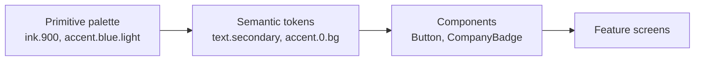

# Design system

The design system is a first-class module, not a styling afterthought. Every screen is built only from its tokens and components. This keeps screens readable, makes light/dark theming free, and gives the interview a concrete "component structure" story.

Decision records: [ADR 0004 — hand-rolled design system, no UI kit](adr/0004-hand-rolled-design-system.md) and [ADR 0006 — visual design language](adr/0006-visual-design-language.md).

## Concept

Each part of the domain has one visual form, so progress reads at a glance:

| Domain term ([`CONTEXT.md`](../CONTEXT.md)) | Visual form | Where it shows |
|---|---|---|
| **Application** | An **accent**: one color, one badge shape, one letter | `CompanyBadge`, `StageProgress`, `StageStep` |
| **Stage** | A **stage marker** with its own shape (Saved → Applied → Interviewing → Offer) | `StageMarker`, `StagePill`, `StageProgress` |
| **Next Step** | A dark **spotlight panel** | `SpotlightCard`, urgent `Badge` |
| Closed application (Rejected, Withdrawn) | The progress strip ends in a bar or an exit mark | `StageMarker`, `StageProgress` |
| AI proposal | **Hatched** fill and dashed border until the user confirms it | `ProposalCard`, `Card variant="proposal"` |

Eyebrow and section text is plain ("UP NEXT", "CURRENT", "Closed: rejected", "PROPOSED · FROM EMAIL"). Domain labels stay plain: stages keep their names, and a Next Step due soon reads "Due tomorrow".

## Screen composition

The Pipeline tab (home) is prep-first, top to bottom:

1. **`NextInterviewCard`** (feature component on `SpotlightCard`): eyebrow "Next interview" (with "+N MORE" when other applications are Interviewing), company badge, company as title, role as subtitle, prep progress ("4 of 10 questions practiced · 1 mock interview", or "Prep not started"), and actions "Practice questions" (primary) and "Mock interview" (secondary). It picks the Interviewing application with the soonest open Next Step (`selectNextInterview`). With no Interviewing application it reads "Interview prep" / "No interviews yet" / "Move an application to Interviewing and its prep questions show up here." and has no actions.
2. **`UpNextCard`**: the next Next Step on a `SpotlightCard` (eyebrow "Up next", action "View").
3. **`ApplicationsCard`**: "Your applications" with "3 active · 0 closed" and one `ApplicationRow` per application. Interviewing rows add a prep line under the role ("4 of 10 practiced · 1 mock" / "Prep not started").
4. **Stats**: questions practiced, then sent this week (`StatTile`).

## Principles

1. **One source of truth.** No raw colors, font sizes, or spacing numbers in feature code. Values come from tokens.
2. **Typed end to end.** Token names, component variants, and theme shape are TypeScript types. A typo is a compile error.
3. **Accessible by default.** Components ship with roles, labels, touch targets, and contrast already handled. Color is never the only signal: stages have shape + icon + word, applications have color + shape + letter.
4. **What matters first.** Bold type, flat white cards on light gray, dark panels for what matters most. Yellow means urgency and nothing else.
5. **Every control is round.** Buttons, chips, icon buttons, and the tab bar are pills or circles; cards and panels are softly rounded rectangles.
6. **Themeable and small.** Light and dark share one semantic token map. Only the components the app needs; each has one job.

## Module layout

```
src/design-system/
  tokens/
    palette.ts        # primitive colors (never imported by features)
    semantic.ts       # light + dark semantic color maps, AccentIndex
    spacing.ts        # 4-pt scale
    radii.ts
    typography.ts     # Overpass / Overpass Mono variants
    elevation.ts
    motion.ts
    sizing.ts         # min touch target per platform
  theme/
    theme.ts          # Theme type = semantic colors + scales
    ThemeProvider.tsx # system scheme + user override from Redux settings
    useTheme.ts
    makeStyles.ts     # typed, memoized per-theme StyleSheet factory
    useScaledIconSize.ts
  components/
    Text.tsx  Stack.tsx  Screen.tsx  Button.tsx  IconButton.tsx
    TextField.tsx  Card.tsx  StagePill.tsx  Badge.tsx  ListItem.tsx
    EmptyState.tsx  ErrorState.tsx  Skeleton.tsx  Banner.tsx  Chip.tsx
    CompanyBadge.tsx  StageMarker.tsx  StageProgress.tsx  StageStep.tsx
    SpotlightCard.tsx  ProposalCard.tsx  StatTile.tsx  ProgressSteps.tsx
    FloatingTabBar.tsx  icons.ts
    Hatch.tsx  stageGlyph.tsx     # internal: hatching, View-built stage shapes
  index.ts            # the only public entry point
```

Feature code imports from `@/design-system` only. Deep imports (`@/design-system/tokens/palette`) are blocked by an ESLint `no-restricted-imports` rule. The accent-assignment helper lives outside the design system in `src/lib/accents.ts`, because it is domain logic.

## Token layers



- **Primitive** tokens are raw values. Only `semantic.ts` and `elevation.ts` read them.
- **Semantic** tokens describe purpose (`text.secondary`, `panel.bg`, `urgent.bg`, `accent[2].bg`). Light and dark map the same names to different primitives.
- **Components** read semantic tokens through `useTheme()` / `makeStyles()`.

### Primitive palette

From `src/design-system/tokens/palette.ts`.

| Scale | Steps |
|---|---|
| ink | 900 `#121417` · 800 `#22272E` · 700 `#2A2F36` · 600 `#4B5058` · 500 `#5C626B` · 400 `#80868F` |
| night | 950 `#0D0F12` · 900 `#171A1F` · 850 `#1E2228` · 800 `#22272E` · 700 `#2A2F36` |
| paper | 0 `#FFFFFF` · 50 `#F2F2EE` · 100 `#EDEDE7` · 200 `#E9E9E3` · 300 `#D6D6CF` |
| fog | 100 `#F2F2EE` · 200 `#C9CCD1` · 300 `#A7ADB6` · 400 `#8D949E` |
| highlight | 500 `#FFD100` (urgency only, always with ink text) |

| Accent | Light | Dark |
|---|---|---|
| blue | `#0061B0` | `#4DA3FF` |
| orange | `#C2410C` | `#FB8B4B` |
| green | `#047857` | `#34D399` |
| purple | `#6D28D9` | `#A78BFA` |

| Feedback | Light fg | Light bg | Dark fg | Dark bg |
|---|---|---|---|---|
| success | `#047857` | `#E3F4EC` | `#34D399` | `#0E2A21` |
| warning | `#7A4A00` | `#FFF4CC` | `#FFD166` | `#3A2C05` |
| danger | `#B42318` | `#FDECEA` | `#FF8A80` | `#3A1714` |
| info | `#0061B0` | `#E5F0FA` | `#4DA3FF` | `#0C2440` |

### Semantic colors

From `src/design-system/tokens/semantic.ts`.

| Token | Light | Dark | Use |
|---|---|---|---|
| `bg.canvas` | `#F2F2EE` paper.50 | `#0D0F12` night.950 | Screen background (light gray) |
| `bg.surface` | `#FFFFFF` paper.0 | `#171A1F` night.900 | Cards, inputs, chips, tab bar |
| `bg.subtle` | `#E9E9E3` paper.200 | `#22272E` night.800 | Pressed rows, neutral badge |
| `panel.bg` | `#121417` ink.900 | `#22272E` night.800 | Dark panels: tab-root headers, spotlight cards, FAB |
| `panel.fg` | `#FFFFFF` paper.0 | `#F2F2EE` fog.100 | Text on panels; `onPanel` button fill |
| `panel.fgSecondary` | `#C9CCD1` fog.200 | `#A7ADB6` fog.300 | Secondary text on panels |
| `border.subtle` | `#D6D6CF` paper.300 | `#2A2F36` night.700 | Decorative hairlines |
| `border.strong` | `#121417` ink.900 | `#F2F2EE` fog.100 | Secondary button outline, inputs, chips |
| `text.primary` | `#121417` ink.900 | `#F2F2EE` fog.100 | Default text |
| `text.secondary` | `#4B5058` ink.600 | `#A7ADB6` fog.300 | Metadata, subtitles |
| `text.tertiary` | `#5C626B` ink.500 | `#8D949E` fog.400 | Hints, captions |
| `text.inverse` | `#FFFFFF` paper.0 | `#121417` ink.900 | Text on `action.primary.bg` |
| `text.link` | `#0061B0` accent.blue | `#4DA3FF` accent.blue | Ghost buttons, links |
| `action.primary.bg` | `#121417` ink.900 | `#F2F2EE` fog.100 | Primary pill, selected chip, focused tab |
| `action.primary.bgPressed` | `#2A2F36` ink.700 | `#C9CCD1` fog.200 | Pressed primary |
| `action.primary.fg` | `#FFFFFF` paper.0 | `#121417` ink.900 | Label on primary |
| `focus.ring` | `#0061B0` | `#4DA3FF` | Focused input border |
| `feedback.{tone}.fg/bg` | see feedback table | see feedback table | Badges, banner rules and icons, field errors |
| `urgent.bg` / `urgent.fg` | `#FFD100` / `#121417` | `#FFD100` / `#121417` | Next Step due within 48 hours or overdue; yellow marks on panels |
| `proposal.border` | `#121417` ink.900 | `#F2F2EE` fog.100 | Dashed 2px proposal border |
| `proposal.hatchA` / `hatchB` | `#FFFFFF` / `#EDEDE7` | `#171A1F` / `#1E2228` | Hatched proposal stripes |
| `accent[0..3].bg` | blue / orange / green / purple light | blue / orange / green / purple dark | Accent color: badges, progress strips, passed stages |
| `accent[0..3].fg` | `#FFFFFF` | `#0D0F12` night.950 | Badge letter |
| `stage.future` | `#80868F` ink.400 | `#8D949E` fog.400 | Unreached stages (dashed) |

There is no per-stage color. Stages are monochrome: shape + icon + word.

### Contrast (WCAG 2.x, computed)

Ratios were computed with the WCAG relative-luminance formula from the hex values above (script run 2026-11-06, not estimated). The dev gallery computes the same figures live on its palette swatches. Thresholds: text ≥ 4.5:1; large text (≥ 18.66 px bold / 24 px) and non-text marks that carry meaning ≥ 3:1.

**Text pairs** — all pass 4.5:1.

| Pair (where used) | Light | Dark |
|---|---|---|
| `text.primary` on `bg.canvas` | 16.44 | 17.10 |
| `text.primary` on `bg.surface` (cards, chips, inputs, banners, stat tiles) | 18.45 | 15.54 |
| `text.primary` on `bg.subtle` (neutral badge, pressed rows) | 15.14 | 13.39 |
| `text.secondary` on `bg.canvas` | 7.23 | 8.50 |
| `text.secondary` on `bg.surface` (subtitles, banner body, stat labels) | 8.12 | 7.72 |
| `text.tertiary` on `bg.canvas` | 5.48 | 6.27 |
| `text.tertiary` on `bg.surface` | 6.15 | 5.70 |
| `text.link` on `bg.surface` (ghost button) | 6.29 | 6.64 |
| `text.link` on `bg.canvas` | 5.61 | 7.31 |
| `action.primary.fg` on `action.primary.bg` (primary button, selected chip, focused tab) | 18.45 | 16.44 |
| `action.primary.fg` on `action.primary.bgPressed` | 13.48 | 11.46 |
| `panel.fg` on `panel.bg` (panel headers, spotlight title; also `onPanel` label `panel.bg` on `panel.fg`) | 18.45 | 13.39 |
| `panel.fgSecondary` on `panel.bg` | 11.46 | 6.65 |
| `urgent.bg` on `panel.bg` (yellow "UP NEXT" eyebrow) | 12.63 | 10.28 |
| `urgent.fg` on `urgent.bg` (urgent badge, "CURRENT") | 12.63 | 12.63 |
| `text.primary` on `proposal.hatchA` | 18.45 | 15.54 |
| `text.primary` on `proposal.hatchB` (worst case under the stripes) | 15.70 | 14.23 |
| `text.secondary` on `proposal.hatchB` | 6.91 | 7.07 |
| `accent[0].fg` on `accent[0].bg` (badge letter, blue) | 6.29 | 7.31 |
| `accent[1].fg` on `accent[1].bg` (orange) | 5.18 | 8.13 |
| `accent[2].fg` on `accent[2].bg` (green) | 5.48 | 9.98 |
| `accent[3].fg` on `accent[3].bg` (purple) | 7.10 | 7.05 |
| `accent[n].bg` as text on `bg.surface` (lowest accent) | 5.18 | 6.41 |
| `feedback.success.fg` on `feedback.success.bg` | 4.81 | 7.96 |
| `feedback.warning.fg` on `feedback.warning.bg` | 6.79 | 9.44 |
| `feedback.danger.fg` on `feedback.danger.bg` | 5.75 | 7.01 |
| `feedback.info.fg` on `feedback.info.bg` | 5.45 | 5.96 |
| `feedback.danger.fg` on `bg.surface` (destructive button, field error) | 6.57 | 7.64 |
| `feedback.danger.fg` on `bg.canvas` (field error) | 5.86 | 8.41 |

**Non-text marks** (WCAG 1.4.11, ≥ 3:1).

| Pair (where used) | Light | Dark | Status |
|---|---|---|---|
| `border.strong` on `bg.surface` (secondary button, inputs, chips) | 18.45 | 15.54 | Pass |
| `border.strong` on `bg.canvas` | 16.44 | 17.10 | Pass |
| `focus.ring` on `bg.surface` | 6.29 | 6.64 | Pass |
| `proposal.border` on `proposal.hatchB` | 15.70 | 14.23 | Pass |
| `accent[n].bg` on `bg.surface` (progress strips, passed stages; lowest accent) | 5.18 | 6.41 | Pass |
| `accent[n].bg` on `bg.canvas` (lowest accent) | 4.61 | 7.05 | Pass |
| `urgent.bg` on `panel.bg` (FAB icon, practiced steps) | 12.63 | 10.28 | Pass |
| `action.primary.bg` on `bg.surface` (focused tab pill) | 18.45 | 15.54 | Pass |
| Badge plate (`panel.badgePlate`, light) on `panel.bg` (badge on a spotlight card) | 18.45 | — | Pass: in light, badges on a panel sit on a white plate |
| `accent[0..3].bg` on the white plate (light) | 6.29 · 5.18 · 5.48 · 7.10 | — | Pass |
| `accent[0..3].bg` on `panel.bg` (dark; the plate matches the panel) | — | 5.72 · 6.37 · 7.82 · 5.52 | Pass |
| `stage.future` on `bg.surface` (unreached stages) | 3.67 | 5.70 | Passes 3:1 (non-text) |
| `stage.future` on `bg.canvas` | 3.27 | 6.27 | Passes 3:1 (non-text) |
| `border.subtle` on `bg.surface` (hairlines, secondary `IconButton` edge) | **1.46** | **1.29** | Below 3:1; decorative only |
| `urgent.bg` on `bg.surface` (urgent badge edge) | **1.46** | 11.94 | Below 3:1 in light; the badge's ink text (12.63) carries it |
| `panel.bg` on `bg.canvas` (panel edge) | 16.44 | **1.28** | Below 3:1 in dark; text inside the panel carries it |

The flagged marks are decorative: the information they sit beside is also given as text (badge letter at ≥ 5.18:1 and the company name; stage word and icon; badge text; panel text), so no meaning is lost. They are listed so that nobody promotes them to sole carriers of meaning. If a future design makes a company badge on a panel or a future stage marker the only signal, the light-theme values must change first.

Any new color pair must be added to these tables with its computed ratio before it is used.

### Stage markers

Each **Stage** (see [`CONTEXT.md`](../CONTEXT.md)) maps to a marker shape, an icon, and a word. Shapes are built from Views.

| Stage | Marker shape | Icon (Ionicons) |
|---|---|---|
| Saved | Hollow dashed circle | `bookmark-outline` |
| Applied | Ring | `paper-plane-outline` |
| Interviewing | Wide pill | `chatbubble-outline` |
| Offer | Filled square | `star-outline` |
| Rejected | Vertical end bar ("Closed: rejected") | `flag-outline` |
| Withdrawn | Diagonal exit bar ("Closed: withdrawn") | `exit-outline` |

State: **passed** uses the accent color, **current** is ink with a yellow halo, **future** uses `stage.future`, dashed. Yellow (`urgent`) otherwise marks only a Next Step due within 48 hours or overdue.

### Accent assignment

`accentFor(applicationId, company)` in `src/lib/accents.ts` gives each application a `CompanyAccent` `{ index: 0 | 1 | 2 | 3, letter }`:

- **Index**: a 31-multiplier string hash of the application ID (unsigned 32-bit), modulo 4. The same ID always gets the same accent, across launches and devices, with nothing stored.
- **Letter**: the company's first letter or digit, upper-cased; `•` when there is none.
- **Shape by index**: 0 circle, 1 rounded square, 2 triangle, 3 diamond (`CompanyBadge`).

There are four accent colors, so they repeat after four applications and two applications can share an accent. The letter and the company name next to every badge tell them apart.

### Spacing (4-pt scale)

| Token | 0 | 1 | 2 | 3 | 4 | 5 | 6 | 8 | 10 | 12 |
|---|---|---|---|---|---|---|---|---|---|---|
| px | 0 | 4 | 8 | 12 | 16 | 20 | 24 | 32 | 40 | 48 |

Screen horizontal padding is `space.4`. Gaps between cards are `space.3`. Section gaps are `space.6`. Card padding is `space.4`.

### Shape (radii)

`sm` 4 · `md` 8 · `lg` 10 · `pill` 999.

Cards and panels use `lg` (10). Inner panels and inputs inside them use `md` (8: 10 minus a 2 px inset). Small marks use `sm`. Every control (buttons, chips, icon buttons, tab bar, FAB) uses `pill`.

### Typography

Overpass (an open-source face based on U.S. highway signage) for display and body; Overpass Mono for dates, counts, and codes. Both come from `@expo-google-fonts/overpass` and `@expo-google-fonts/overpass-mono` and load in `src/app/_layout.tsx` (`APP_FONTS`, via `expo-font`'s `useFonts`) while the splash screen is still up. If loading fails, the app starts with system fonts. Custom fonts carry their weight in the family name, so variants set `fontFamily`, not `fontWeight`.

| Variant | Size / line height | Family | Use |
|---|---|---|---|
| `display` | 34 / 40 | Overpass Black (900) | Panel titles on tab roots ("Today"), empty-state heroes |
| `title` | 28 / 34 | Overpass Black (900) | Screen titles ("Acme Health") |
| `feature` | 22 / 28 | Overpass ExtraBold (800) | Spotlight titles ("Book the onsite") |
| `heading` | 18 / 24 | Overpass ExtraBold (800) | Card titles, section headers |
| `body` | 16 / 22 | Overpass Regular (400) | Default text |
| `bodyStrong` | 16 / 22 | Overpass Bold (700) | Emphasis |
| `bodySmall` | 14 / 20 | Overpass Regular (400) | Metadata (company, location, dates) |
| `caption` | 12 / 16 | Overpass SemiBold (600) | Helper text |
| `overline` | 12 / 16, tracking 0.8, UPPERCASE | Overpass ExtraBold (800) | Stage names, eyebrows: SAVED · APPLIED · INTERVIEW |
| `mono` | 13 / 18, tracking 0.4, UPPERCASE | Overpass Mono Bold (700) | Dates and status text: DUE TOMORROW · SAT 7 NOV |

`overline` and `mono` upper-case through `textTransform`, so the stored text stays sentence case ("Due tomorrow") and screen readers read words, not letters. Dynamic Type / font scaling stays on. `maxFontSizeMultiplier` is capped at 1.8 for `feature` and 1.6 for `display`, `title`, `caption`, `overline`, and `mono`; body and heading text are uncapped. Text containers have no fixed heights so large text wraps.

### Elevation

The design is flat: white cards on light gray, no borders or shadows. Uses React Native's cross-platform `boxShadow` style.

| Token | Use |
|---|---|
| `elevation.0`, `elevation.1` | Flat (no shadow) |
| `elevation.2` | Floating controls only: `FloatingTabBar`, its FAB |

Dark theme drops shadows; surfaces separate by `bg.*` steps.

### Motion

| Token | ms | Use |
|---|---|---|
| `motion.fast` | 120 | Press feedback |
| `motion.base` | 200 | State changes, banner in/out |
| `motion.slow` | 320 | Larger transitions |

When the OS "Reduce Motion" setting is on, every duration becomes `0` (`theme.reduceMotion` is `true`) and skeleton shimmer is replaced with a static fill.

## Theming API

```ts
// src/design-system/theme/theme.ts
export type ColorScheme = 'light' | 'dark';
export type ThemePreference = ColorScheme | 'system';

export interface Theme {
  scheme: ColorScheme;
  color: SemanticColors;   // from semantic.ts, fully typed
  space: typeof space;
  radius: typeof radii;
  size: typeof sizing;     // minTouchTarget: 44 iOS / 48 Android
  type: typeof typography;
  maxFontSizeMultiplier: typeof maxFontSizeMultiplier;
  elevation: Record<ElevationLevel, ViewStyle>;
  motion: Motion;          // all 0 when Reduce Motion is on
  reduceMotion: boolean;
}
```

```ts
// usage in a component
const useStyles = makeStyles((t) => ({
  card: {
    backgroundColor: t.color.bg.surface,
    borderRadius: t.radius.lg,
    padding: t.space[4],
    gap: t.space[2],
  },
}));
```

- `ThemeProvider` resolves `ThemePreference` (stored in the Redux `settings` slice) against `useColorScheme()`, and reads the OS Reduce Motion setting.
- `makeStyles` builds one `StyleSheet` per scheme and memoizes it. Switching theme does not rebuild styles on every render.
- Components never branch on `scheme`. If a component needs a different value in dark mode, that value becomes a semantic token.

## Components

Each component has a typed props interface, string-union variants, accessibility defaults, and a gallery entry. All are exported from `@/design-system`; none import the store, navigation, or feature code.

| Component | Key props | Accessibility defaults |
|---|---|---|
| `Text` | `variant?: TypographyVariant`, `color?: 'primary' \| 'secondary' \| 'tertiary' \| 'inverse' \| 'link' \| 'onPanel' \| 'onPanelSecondary'` | Font-scaling caps above; `accessibilityRole="header"` for `display`, `title`, `heading` |
| `Stack` | `direction`, `gap`, `padding`, `align`, `justify`, `flex`, `wrap` | Layout only; no visual styles |
| `Screen` | `title?`, `eyebrow?`, `headerRight?`, `onBack?`, `scroll?`, `header?: 'plain' \| 'panel'` | Safe-area aware; title keeps the header role; back is a round `IconButton` labelled "Back" |
| `Button` | `label`, `onPress`, `variant?: 'primary' \| 'secondary' \| 'ghost' \| 'destructive' \| 'onPanel'`, `size?: 'md' \| 'lg'`, `icon?`, `trailingIcon?`, `loading?`, `disabled?` | Min touch target even for `ghost` (underlined text, no box); `accessibilityState` busy/disabled; label required |
| `IconButton` | `icon`, `accessibilityLabel`, `onPress`, `variant?: 'primary' \| 'secondary' \| 'ghost' \| 'onPanel'` | Round; `accessibilityLabel` is a required prop; min touch target |
| `TextField` | `label`, `value`, `onChangeText`, `helperText?`, `error?`, `multiline?`, `secure?` | Radius `md`, 1.5 px `border.strong`, 2 px `focus.ring` when focused; label announced; error announced on change |
| `Card` | `children`, `onPress?`, `accessibilityLabel?`, `accessibilityHint?`, `variant?: 'surface' \| 'panel' \| 'proposal'` | Pressable cards get `accessibilityRole="button"` |
| `Chip` | `label`, `onPress`, `selected?`, `icon?` | Round; selected = ink fill; `accessibilityState.selected` |
| `StagePill` | `stage` | Stage label (current `StageMarker` + icon + word, no tint); announces "Stage: Interviewing" |
| `Badge` | `label`, `tone?: 'neutral' \| 'info' \| 'success' \| 'warning' \| 'danger' \| 'urgent'`, `icon?` | Text always present; `urgent` = yellow, ink `mono` text, clock icon |
| `ListItem` | `title`, `subtitle`, `leading`, `trailing`, `onPress` | Combined label for the row |
| `Banner` | `tone`, `title`, `body?`, `action?` | Flat surface with a 4 px left rule and icon in the tone color; announced politely |
| `EmptyState` | `icon`, `title`, `body`, `action` | Hero text is a header |
| `ErrorState` | `error: AppError`, `onRetry?` | Maps `AppError.kind` to plain-language copy; retry focusable first |
| `Skeleton` | `width`, `height`, `radius` | Hidden from screen readers; parent sets `accessibilityState={{ busy: true }}` |
| `CompanyBadge` | `accent: AccentIndex`, `letter`, `size?: 'sm' \| 'md' \| 'lg'` (24/32/44), `surface?: CompanyBadgeSurface` | Shape by accent index; decorative, hidden from screen readers |
| `StageMarker` | `stage`, `state: StageState` (`'passed' \| 'current' \| 'future'`), `accent?` | Decorative; the adjacent label names the stage |
| `StageProgress` | `stage`, `accent` | Four stage markers; reached segments solid, unreached dotted; closed applications end in a bar or exit mark. Decorative (the row label carries the stage) |
| `StageProgressLegend` | — | SAVED · APPLIED · INTERVIEW · OFFER captions aligned with `StageProgress` |
| `StageStep` | `stage`, `state`, `accent`, `label`, `meta?`, `tag?`, `onPress?`, `accessibilityLabel?`, `selected?`, `last?`, `children?` | When pressable: a button named `accessibilityLabel ?? label` with `accessibilityState.selected` |
| `SpotlightCard` | `eyebrow`, `count?`, `accent?: { index, letter }`, `title`, `subtitle?`, `urgentLabel?`, `action?: { label, onPress }`, `onDone?`, `onDoneLabel?` | Dark panel; urgency is shown as text (`urgentLabel`), not just yellow; badge decorative |
| `ProposalCard` | `eyebrow`, `onDevice?`, `children` | Dashed border + hatched fill; container label starts "Proposal, not saved" |
| `StatTile` | `icon`, `value`, `label` | Big number + caption on a white card |
| `ProgressSteps` | `total`, `done` | Announces "6 of 20 practiced" |
| `FloatingTabBar` | `tabs: { key, label, icon, focused, onPress, badge? }[]`, `action?: { icon, accessibilityLabel, onPress }` | Tabs keep `accessibilityRole="tab"` and visible names; FAB is a round ink button with a yellow icon; `elevation.2` |

### Component rules

1. **Props are unions, not booleans.** `variant="destructive"`, not `isDestructive`.
2. **No `style` escape hatch for visuals.** Components accept layout-only props (`flex`, `alignSelf`, margins via `Stack`). If a screen needs a new look, add a variant.
3. **Required accessibility props are required types.** An `IconButton` without `accessibilityLabel` does not compile.
4. **Loading and error are component states**, not ad-hoc spinners. Every async screen renders `Skeleton` → content, or `ErrorState` with retry.
5. **No business logic.** Components don't import from `src/features`, the store, or navigation. `StageMarker` takes a `Stage`; `CompanyBadge` takes an accent index and letter that the feature got from `accentFor`.
6. **Shapes from Views.** Badges, stage markers, hatching, and dashed lines are built from Views (`borderStyle`, rotation, `overflow: 'hidden'`). No `react-native-svg`: it is a native module and would need a dev-client rebuild.

## Accessibility checklist

Every component and screen PR passes this list:

- [ ] Touch targets ≥ 44×44 pt (iOS) / 48×48 dp (Android) via size or `hitSlop`
- [ ] Every interactive element has a role and a label
- [ ] Text contrast ≥ 4.5:1 and meaningful marks ≥ 3:1 (tables above)
- [ ] Works at the largest Dynamic Type / font scale without clipped text
- [ ] Color is never the only signal (stages: shape + icon + word; applications: color + shape + letter)
- [ ] Reduced Motion respected
- [ ] VoiceOver / TalkBack reading order matches visual order; decorative shapes hidden

## Gallery screen

`src/app/dev/design-system.tsx` is the design-system sheet in the app ([UX-6](user-stories.md#ux-6--browse-the-design-system-presenter-)): panel header, palette swatches with hex and live-computed contrast, type scale, spacing, radii, elevation, motion, stage markers for all six stages in every state, company badges for the four accents in every size, a `StageProgress` per stage, a `StageStep` timeline, `SpotlightCard`, `ProposalCard` next to a confirmed card, every `Card` variant, badges, buttons and icon buttons in every variant, chips, text fields, banners, `StatTile`, `ProgressSteps`, a `FloatingTabBar` sample, list rows, skeletons, and empty/error states. The header button switches the sheet between light and dark. It is reachable only in development builds (`__DEV__`).

Why an in-app gallery instead of Storybook: it ships with no extra build setup, runs on the same simulator as the demo, and shows the real components with the real fonts on the real device. Storybook for React Native is a reasonable upgrade if the component count grows.

## Enforcement

| Rule | Mechanism |
|---|---|
| No color literals in feature code (palette is the only exception) | `eslint-plugin-react-native` → `no-color-literals` |
| No inline style objects | `eslint-plugin-react-native` → `no-inline-styles` |
| No deep imports into the design system | ESLint `no-restricted-imports` (`@/design-system/*`) |
| Required accessibility props | TypeScript prop types |
| Component behavior (roles, states, labels, error copy) | Jest + React Native Testing Library, queried by role and label |
| Contrast | Ratios computed by script and recorded above; new pairs added before use |
