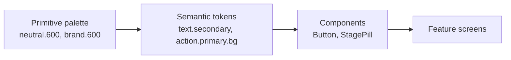

# Design system

The design system is a first-class module, not a styling afterthought. Every screen is built only from its tokens and components. This keeps screens readable, makes light/dark theming free, and gives the interview a concrete "component structure" story.

Decision record: [ADR 0004 — hand-rolled design system, no UI kit](adr/0004-hand-rolled-design-system.md).

## Goals

1. **One source of truth.** No raw colors, font sizes, or spacing numbers in feature code. Values come from tokens.
2. **Typed end to end.** Token names, component variants, and theme shape are TypeScript types. A typo is a compile error.
3. **Accessible by default.** Components ship with roles, labels, touch targets, and contrast already handled. Feature code can't easily get these wrong.
4. **Themeable.** Light and dark themes share one semantic token map. Components never check which theme is active.
5. **Small.** Only the components the app needs. Each one has one job.

## Module layout

```
src/design-system/
  tokens/
    palette.ts        # primitive colors (never imported by features)
    semantic.ts       # light + dark semantic color maps
    spacing.ts        # 4-pt scale
    radii.ts
    typography.ts
    elevation.ts
    motion.ts
  theme/
    theme.ts          # Theme type = semantic colors + scales
    ThemeProvider.tsx # system scheme + user override from Redux settings
    useTheme.ts
    makeStyles.ts     # typed, memoized per-theme StyleSheet factory
  components/
    Text.tsx  Stack.tsx  Screen.tsx  Button.tsx  IconButton.tsx
    TextField.tsx  Card.tsx  StagePill.tsx  Badge.tsx  ListItem.tsx
    EmptyState.tsx  ErrorState.tsx  Skeleton.tsx  Banner.tsx
  index.ts            # the only public entry point
```

Feature code imports from `@/design-system` only. Deep imports (`@/design-system/tokens/palette`) are blocked by an ESLint `no-restricted-imports` rule.

## Token layers



- **Primitive** tokens are raw values. Only `semantic.ts` reads them.
- **Semantic** tokens describe purpose (`text.secondary`, `bg.surface`, `stage.offer.fg`). Light and dark themes map the same names to different primitives.
- **Components** read semantic tokens through `useTheme()` / `makeStyles()`.

### Primitive palette

| Scale | 50 | 100 | 200 | 300 | 400 | 500 | 600 | 700 | 800 | 900 | 950 |
|---|---|---|---|---|---|---|---|---|---|---|---|
| neutral | `#F7F8FA` | `#EEF0F4` | `#DDE1E8` | `#C3C9D4` | `#9AA3B2` | `#636C7E` | `#4E5668` | `#384052` | `#252B38` | `#161A23` | `#0D1017` |
| brand (indigo) | `#EEF0FF` | `#DDE1FF` | — | `#A3ADFF` | `#8591F7` | `#5B67E8` | `#4651D1` | `#3740AD` | `#2B3287` | `#1F2463` | — |

Feedback hues use four steps (`100`, `300`, `700`, `900`):

| Hue | 100 | 300 | 700 | 900 |
|---|---|---|---|---|
| success | `#DDF5E8` | `#7FD3A6` | `#17703F` | `#0E3F24` |
| warning | `#FFF1D6` | `#F5C26B` | `#8A5300` | `#4A2D00` |
| danger | `#FDE3E3` | `#F29B9B` | `#A62B2B` | `#5C1717` |
| info | `#DCEFFD` | `#8CC4F0` | `#175A91` | `#0C3354` |

`neutral.0` is `#FFFFFF`.

### Semantic colors

| Token | Light | Dark |
|---|---|---|
| `bg.canvas` | neutral.50 | neutral.950 |
| `bg.surface` | neutral.0 | neutral.900 |
| `bg.subtle` | neutral.100 | neutral.800 |
| `border.subtle` | neutral.200 | neutral.800 |
| `border.strong` | neutral.300 | neutral.700 |
| `text.primary` | neutral.900 | neutral.50 |
| `text.secondary` | neutral.600 | neutral.300 |
| `text.tertiary` | neutral.500 | neutral.400 |
| `text.inverse` | neutral.0 | neutral.950 |
| `text.link` | brand.600 | brand.300 |
| `action.primary.bg` | brand.600 | brand.400 |
| `action.primary.bgPressed` | brand.700 | brand.300 |
| `action.primary.fg` | neutral.0 | neutral.950 |
| `focus.ring` | brand.500 | brand.300 |
| `feedback.{success,warning,danger,info}.bg` | hue.100 | hue.900 |
| `feedback.{success,warning,danger,info}.fg` | hue.700 | hue.300 |

### Contrast (WCAG 2.x, checked)

Every text/background pair specified below meets AA (≥ 4.5:1). Ratios were computed from the hex values above. Other combinations of palette colors are not covered and must not be used for text until they are added here.

| Pair | Light | Dark |
|---|---|---|
| `text.primary` on `bg.canvas` | 16.38 | 17.91 |
| `text.secondary` on canvas (light) / surface (dark) | 6.92 | 10.47 |
| `text.tertiary` on canvas (light) / surface (dark) | 4.97 | 6.84 |
| `action.primary.fg` on `action.primary.bg` | 6.25 | 6.70 |
| `action.primary.fg` on `action.primary.bgPressed` | 8.40 | 9.04 |
| `text.link` on `bg.surface` | 6.25 | 8.27 |
| Stage pill fg on bg (lowest of all stages) | 5.34 | 6.25 |
| `text.primary` on `bg.surface` (cards, chips, list rows) | 17.41 | 16.38 |
| `text.primary` on `bg.subtle` (neutral banner, pressed rows) | 15.26 | 13.34 |
| `text.secondary` on `bg.surface` (list subtitles) | 7.36 | 10.47 |
| `feedback.warning.fg` on `feedback.warning.bg` (urgent badge, warning banner) | 5.67 | 7.69 |
| `feedback.info.fg` on `feedback.info.bg` | 6.12 | 6.97 |
| `feedback.success.fg` on `feedback.success.bg` | 5.34 | 6.71 |
| `feedback.danger.fg` on `feedback.danger.bg` (destructive button, danger banner) | 5.75 | 6.25 |

Any new color pair must be added to this table with its ratio before it is used.

### Stage colors

Each **Stage** (see [`CONTEXT.md`](../CONTEXT.md)) maps to a hue, an icon, and a label. Color is never the only signal: the pill always shows the label, and the icon differs per stage.

| Stage | Hue | Icon (Ionicons) | Light pill (fg / bg) | Dark pill (fg / bg) |
|---|---|---|---|---|
| Saved | neutral | `bookmark-outline` | 700 / 100 | 300 / 800 |
| Applied | info | `paper-plane-outline` | 700 / 100 | 300 / 900 |
| Interviewing | brand | `chatbubbles-outline` | 700 / 100 | 300 / 900 |
| Offer | success | `trophy-outline` | 700 / 100 | 300 / 900 |
| Rejected | danger | `close-circle-outline` | 700 / 100 | 300 / 900 |
| Withdrawn | neutral | `exit-outline` | 700 / 100 | 300 / 800 |

`warning` is reserved for **Next Step** urgency (due within 48 hours or overdue), not for a stage.

### Spacing (4-pt scale)

| Token | 0 | 1 | 2 | 3 | 4 | 5 | 6 | 8 | 10 | 12 |
|---|---|---|---|---|---|---|---|---|---|---|
| px | 0 | 4 | 8 | 12 | 16 | 20 | 24 | 32 | 40 | 48 |

Screen horizontal padding is `space.4`. Gaps between cards are `space.3`. Section gaps are `space.6`.

### Radii

`sm` 6 · `md` 10 · `lg` 16 · `pill` 999. Cards use `lg`, inputs and buttons use `md`, pills use `pill`.

### Typography

System fonts (SF Pro on iOS, Roboto on Android). No custom font loading, so there is no font flash and no extra startup work.

| Variant | Size / line height | Weight | Use |
|---|---|---|---|
| `display` | 32 / 40 | 700 | Empty-state hero only |
| `title` | 22 / 28 | 600 | Screen titles |
| `heading` | 17 / 22 | 600 | Card titles, section headers |
| `body` | 16 / 24 | 400 | Default text |
| `bodyStrong` | 16 / 24 | 600 | Emphasis inside body |
| `bodySmall` | 14 / 20 | 400 | Metadata (company, location, dates) |
| `caption` | 12 / 16 | 500 | Pills, helper text |

Dynamic Type / font scaling stays on. `maxFontSizeMultiplier` is capped at `1.6` for `display`, `title`, and `caption` so layouts don't break; body text is uncapped.

### Elevation

Uses React Native's cross-platform `boxShadow` style (New Architecture), so iOS and Android share one definition.

| Token | Use |
|---|---|
| `elevation.0` | Flat; cards on `bg.canvas` use a `border.subtle` hairline instead |
| `elevation.1` | Raised cards, sticky headers |
| `elevation.2` | Sheets, toasts, banners |

Dark theme drops shadows and uses `bg.surface` steps instead, since shadows are barely visible on dark backgrounds.

### Motion

| Token | ms | Use |
|---|---|---|
| `motion.fast` | 120 | Press feedback |
| `motion.base` | 200 | Stage pill change, banner in/out |
| `motion.slow` | 320 | Sheet open |

When the OS "Reduce Motion" setting is on, durations become `0` and skeleton shimmer is replaced with a static fill.

## Theming API

```ts
// src/design-system/theme/theme.ts
export type ColorScheme = 'light' | 'dark';
export type ThemePreference = ColorScheme | 'system';

export interface Theme {
  scheme: ColorScheme;
  color: SemanticColors;   // generated from semantic.ts, fully typed
  space: typeof space;
  radius: typeof radii;
  type: typeof typography;
  elevation: Record<ElevationLevel, ViewStyle>;
  motion: typeof motion;
}
```

```ts
// usage in a component
const useStyles = makeStyles((t) => ({
  card: {
    backgroundColor: t.color.bg.surface,
    borderRadius: t.radius.lg,
    padding: t.space[4],
    gap: t.space[2],
  },
}));
```

- `ThemeProvider` resolves `ThemePreference` (stored in the Redux `settings` slice) against `useColorScheme()`.
- `makeStyles` builds one `StyleSheet` per scheme and memoizes it. Switching theme does not rebuild styles on every render.
- Components never branch on `scheme`. If a component needs a different value in dark mode, that value becomes a semantic token.

## Components

Each component has a typed props interface, string-union variants, accessibility defaults, and a gallery entry.

| Component | Variants / key props | Accessibility defaults |
|---|---|---|
| `Text` | `variant`, `color` (semantic text token), `numberOfLines` | Inherits font scaling rules above; `accessibilityRole="header"` when `variant` is `title` or `heading` |
| `Stack` | `direction` (`row`/`column`), `gap` (space token), `align`, `justify` | Layout only; no visual styles |
| `Screen` | `scroll`, `title`, `headerRight` | Safe-area aware; sets screen title for screen readers |
| `Button` | `variant` (`primary`/`secondary`/`ghost`/`destructive`), `size` (`md`/`lg`), `loading`, `disabled`, `icon` | Min 44×44 pt hit area; `accessibilityState` busy/disabled; label required at type level |
| `IconButton` | `icon`, `variant` | `accessibilityLabel` is a **required** prop; 44×44 pt min |
| `TextField` | `label`, `helperText`, `error`, `multiline`, `secure` | Label is announced; error text linked and announced on change |
| `Card` | `onPress?`, `elevated` | Pressable cards get `accessibilityRole="button"` |
| `StagePill` | `stage` | Announces "Stage: Interviewing" |
| `Badge` | `tone` (`neutral`/`info`/`success`/`warning`/`danger`) | Text always present |
| `ListItem` | `title`, `subtitle`, `leading`, `trailing`, `onPress` | Combined label for the row |
| `EmptyState` | `icon`, `title`, `body`, `action` | Hero text is a header |
| `ErrorState` | `error: AppError`, `onRetry?` | Maps `AppError.kind` to plain-language copy; retry button focusable first |
| `Skeleton` | `width`, `height`, `radius` | Hidden from screen readers; parent sets `accessibilityState={{ busy: true }}` |
| `Banner` | `tone`, `title`, `action?` | Announced politely with `AccessibilityInfo.announceForAccessibility` |

### Component rules

1. **Props are unions, not booleans.** `variant="destructive"`, not `isDestructive`.
2. **No `style` escape hatch for visuals.** Components accept layout-only props (`flex`, `alignSelf`, margins via `Stack`). If a screen needs a new look, add a variant.
3. **Required accessibility props are required types.** An `IconButton` without `accessibilityLabel` does not compile.
4. **Loading and error are component states**, not ad-hoc spinners. Every async screen renders `Skeleton` → content, or `ErrorState` with retry.
5. **No business logic.** Components don't import from `src/features` or the store. `StagePill` takes a `Stage` value; it doesn't look one up.

## Accessibility checklist

Every component and screen PR passes this list:

- [ ] Touch targets ≥ 44×44 pt (iOS) / 48×48 dp (Android) via `hitSlop` or size
- [ ] Every interactive element has a role and a label
- [ ] Text contrast ≥ 4.5:1 (table above)
- [ ] Works at the largest Dynamic Type / font scale without clipped text
- [ ] Color is never the only signal (stage pills show label + icon)
- [ ] Reduced Motion respected
- [ ] VoiceOver / TalkBack reading order matches visual order

## Gallery screen

`src/app/dev/design-system.tsx` renders every token and component in both themes, with a theme toggle at the top. It is reachable only in development builds (`__DEV__`).

Why an in-app gallery instead of Storybook: it ships with no extra build setup, runs on the same simulator as the demo, and shows the real components on the real device. Storybook for React Native is a reasonable upgrade if the component count grows.

## Enforcement

| Rule | Mechanism |
|---|---|
| No color literals in feature code | `eslint-plugin-react-native` → `no-color-literals` |
| No inline style objects | `eslint-plugin-react-native` → `no-inline-styles` |
| No deep imports into the design system | ESLint `no-restricted-imports` |
| Required accessibility props | TypeScript prop types |
| Component behavior (roles, disabled, loading, error copy) | Jest + React Native Testing Library, queried by role and label |
