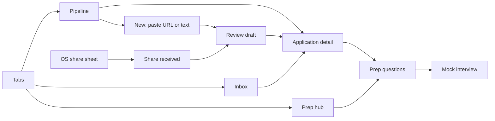

# Features and build tiers

Build in tier order. Each tier ends in a working, demo-able app. Terms follow [`CONTEXT.md`](../CONTEXT.md).

| Tier | Scope | Estimate | Status |
|---|---|---|---|
| 0 | Scaffold, tooling, design system foundation, on-device AI spike | 6.5 h | Done |
| 1 | Pipeline: applications CRUD, stages, persistence | 8 h | Done |
| 2 | AI intake (paste + share), prep questions, AI availability gating | 8.5 h | Done (share sheet from Safari/Chrome: manual check open) |
| 3 | AI mock interview | 6 h | Done |
| 4 | Mock inbox with AI triage and next steps | 6.5 h | Done |
| 5 | Polish, tests, README, demo rehearsal | 4 h | Done except the screen-reader pass and the presenter's own rehearsal |
| Stretch | Pasted interview reviews → summary · Gmail `EmailSource` | 2 h · 10 h | Reviews done · Gmail built and tested with injected fetch; live sign-in blocked on Google OAuth client IDs |

Tiers 0–5 total about **39.5 hours**.

## Screens

## Tier 0 — Scaffold and design system foundation

- Expo SDK 58 app with Expo Router, TypeScript flags from [`architecture.md`](architecture.md#typescript-rules), path alias `@/` → `src/`.
- ESLint (design-system and import rules), Prettier, Jest with `jest-expo`, GitHub Actions running `tsc`, ESLint, Jest.
- Design system tokens, `ThemeProvider`, `makeStyles`, and the components needed by tier 1: `Text`, `Stack`, `Screen`, `Button`, `IconButton`, `TextField`, `Card`, `StagePill`, `EmptyState`, `ErrorState`, `Skeleton`.
- Gallery screen at `/dev/design-system`.
- Redux store with typed hooks, `PersistGate`, `settings` slice (theme preference).
- **On-device AI spike** (1.5 h): install the chosen library in the dev build and run the [spike gate](adr/0005-on-device-apple-foundation-models.md#spike-gate-tier-0). If it fails, try the fallback library; if both fail, stop and decide with the user before tier 2.

**Stories:** [UX-1](user-stories.md#ux-1--choose-light-dark-or-system-theme-), [UX-6](user-stories.md#ux-6--browse-the-design-system-presenter-).

**Engineering done when:** the app launches on iOS Simulator and Android Emulator, the gallery renders every component in light and dark, CI passes, and the AI spike gate has a recorded pass or fail.

## Tier 1 — Pipeline

- Pipeline tab (home), prep-first: a **Next interview** card (prep progress, "Practice questions", "Mock interview"), then the "Up next" Next Step, then applications grouped by **Stage** with counts and an empty state, with a status filter ("All" plus one chip per status that has applications).
- Create an application manually (form validated by the `Application` Zod schema).
- Application detail: fields, stage changer, notes, **Next Steps** list (add, complete).
- Edit and delete with confirmation.
- Persistence across app restarts.

**Stories:** [PIPE-1 – PIPE-8](user-stories.md#pipeline), [UX-2 – UX-5](user-stories.md#experience--accessibility).

**Engineering done when:** selectors `selectApplicationsByStage`, `selectUpcomingNextSteps`, and `selectPipelineCounts` have unit tests.

## Tier 2 — AI intake and prep questions

- Dev build with the `expo-sharing` plugin enabled (iOS share extension, Android intent filter for `text/plain` URLs).
- `+native-intent.ts` routes incoming shares to `/intake/share`.
- New-application screen: paste a URL or the listing text.
- `OnDeviceModel` adapter (`foundationModels.ios.ts`, non-iOS stub `foundationModels.ts`), `capabilities` slice, and `selectAiAvailability`.
- `extractListing` task: fetch URL on device (if given) → readability check → trim to context budget → on-device extraction → **Application Draft**.
- Review-draft screen: every extracted field is editable; confirm creates the application.
- `prepQuestions` task and a questions screen per application, grouped by type, with "mark practiced".

**Stories:** [INT-1 – INT-6](user-stories.md#intake), [PREP-1 – PREP-3](user-stories.md#prep-questions), [UX-7](user-stories.md#ux-7--know-when-ai-isnt-available-).

**Engineering done when:** adapter error mapping, `budget.ts` trimming, and the `ListingExtraction` / `PrepQuestionSet` schemas have unit tests; prompts checked by hand against 5 sample listings; time limits set from measured latency.

## Tier 3 — Mock interview

- Start a **Mock Interview Session** from an application.
- Turn-based text chat: AI asks a question, the user answers, AI returns **Answer Feedback** (strengths, gaps, a stronger example answer) and the next question.
- Sessions persist; the user can leave and resume.
- End session → summary of feedback.

**Stories:** [MOCK-1 – MOCK-5](user-stories.md#mock-interview).

**Engineering done when:** every AI turn is validated against `MockInterviewTurn` with Zod, and a 6-turn session stays within the context budget.

## Tier 4 — Mock inbox and next steps

- `EmailSource` interface and `MockEmailSource` with about 8 fixture messages.
- Inbox tab: messages with triage status (pending, done, failed).
- Dev-only "Receive next email" button appends the next fixture.
- `triage-message` endpoint: category, matched application (or none), proposed next step with due date, confidence.
- Accepting a proposed next step adds it to the matched application; low-confidence matches ask the user to choose.

**Stories:** [INBX-1 – INBX-6](user-stories.md#inbox).

**Engineering done when:** triage matching has unit tests driven by the fixture messages, including an unknown application ID.

## Tier 5 — Polish and rehearsal

- Screen tests for the intake flow (success and failure).
- README setup steps verified from a clean clone.
- Accessibility pass with VoiceOver and TalkBack.
- Record a 20–30 s backup video of the AI flows.
- Rehearse [`demo-script.md`](demo-script.md) twice with a timer.

## Stretch

- **Interview review summary** ([LATER-1](user-stories.md#later-1--summarize-interview-reviews-i-found)). The user pastes interview reviews they found (e.g. from Glassdoor); AI summarizes likely questions with the source text quoted. No scraping of any site.
- **Gmail `EmailSource`** ([LATER-2](user-stories.md#later-2--connect-my-real-gmail)). OAuth with a read-only Gmail scope for test users only. Publishing publicly would need Google's verification. Triage runs on the device, so email content would not be sent to any AI service.

## Out of scope

- Automated collection from Glassdoor or other review sites (no supported integration identified).
- Accounts, sync, or a backend database. Data is local to the device.
- Web target.
- Voice mock interviews.
- AI on Android (no Apple Intelligence; AI is gated off, see UX-7).
- Cloud AI models or a backend AI proxy ([ADR 0005](adr/0005-on-device-apple-foundation-models.md)).
