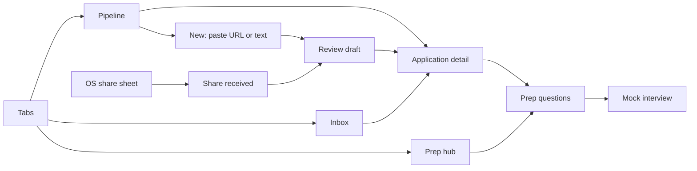

# Features and build tiers

Build in tier order. Each tier ends in a working, demo-able app. Terms follow [`CONTEXT.md`](../CONTEXT.md).

| Tier | Scope | Estimate | Status |
|---|---|---|---|
| 0 | Scaffold, tooling, design system foundation | 5 h | Not started |
| 1 | Pipeline: applications CRUD, stages, persistence | 8 h | Not started |
| 2 | AI intake (paste + share) and prep questions | 9.5 h | Not started |
| 3 | AI mock interview | 5 h | Not started |
| 4 | Mock inbox with AI triage and next steps | 6.5 h | Not started |
| 5 | Polish, tests, README, demo rehearsal | 4 h | Not started |
| Stretch | Pasted interview reviews → summary · Gmail `EmailSource` | 2 h · 10 h | Not planned |

Tiers 0–5 total about **38 hours**.

## Screens

## Tier 0 — Scaffold and design system foundation

- Expo SDK 58 app with Expo Router, TypeScript flags from [`architecture.md`](architecture.md#typescript-rules), path alias `@/` → `src/`.
- ESLint (design-system and import rules), Prettier, Jest with `jest-expo`, GitHub Actions running `tsc`, ESLint, Jest.
- Design system tokens, `ThemeProvider`, `makeStyles`, and the components needed by tier 1: `Text`, `Stack`, `Screen`, `Button`, `IconButton`, `TextField`, `Card`, `StagePill`, `EmptyState`, `ErrorState`, `Skeleton`.
- Gallery screen at `/dev/design-system`.
- Redux store with typed hooks, `PersistGate`, `settings` slice (theme preference).

**Done when:** the app launches on iOS Simulator and Android Emulator, the gallery renders every component in light and dark, and CI passes.

## Tier 1 — Pipeline

- Pipeline tab: applications grouped by **Stage**, with counts and an empty state.
- Create an application manually (form validated by the `Application` Zod schema).
- Application detail: fields, stage changer, notes, **Next Steps** list (add, complete).
- Edit and delete with confirmation.
- Persistence across app restarts.

**Acceptance criteria**

1. Creating an application with a blank company or role shows field errors and doesn't save.
2. Changing stage moves the card to the new group immediately and survives restart.
3. A next step due within 48 hours shows a warning badge on the pipeline card.
4. All interactive elements pass the [accessibility checklist](design-system.md#accessibility-checklist).
5. Selectors `selectApplicationsByStage`, `selectUpcomingNextSteps`, `selectPipelineCounts` have unit tests.

## Tier 2 — AI intake and prep questions

- Dev build with the `expo-sharing` plugin enabled (iOS share extension, Android intent filter for `text/plain` URLs).
- `+native-intent.ts` routes incoming shares to `/intake/share`.
- New-application screen: paste a URL or the listing text.
- `extract-listing` endpoint: fetch URL (if given) → readability check → model extraction → **Application Draft**.
- Review-draft screen: every extracted field is editable; confirm creates the application.
- `prep-questions` endpoint and a questions screen per application, grouped by type, with "mark practiced".

**Acceptance criteria**

1. Sharing a listing URL from Safari (iOS) or Chrome (Android) opens the app on the share-received screen with the URL filled in.
2. A pasted listing produces a draft with company and role filled in; the user can edit any field before confirming.
3. A URL that is blocked, empty, behind a login, or JavaScript-only shows "Couldn't read this page" and switches to paste mode with the URL kept.
4. A model response that fails Zod validation shows `ErrorState` with retry, and offers "Fill in manually".
5. Turning off network during extraction shows the network error within 15 s; nothing is saved.
6. No draft becomes an application without an explicit confirm tap.

## Tier 3 — Mock interview

- Start a **Mock Interview Session** from an application.
- Turn-based text chat: AI asks a question, the user answers, AI returns **Answer Feedback** (strengths, gaps, a stronger example answer) and the next question.
- Sessions persist; the user can leave and resume.
- End session → summary of feedback.

**Acceptance criteria**

1. Each AI turn validates against `MockInterviewTurn`; a failed turn keeps the user's answer text and offers retry.
2. Leaving mid-session and returning restores the transcript.
3. Questions reference the application's role and requirements (checked manually against two different listings).

## Tier 4 — Mock inbox and next steps

- `EmailSource` interface and `MockEmailSource` with about 8 fixture messages.
- Inbox tab: messages with triage status (pending, done, failed).
- Dev-only "Receive next email" button appends the next fixture.
- `triage-message` endpoint: category, matched application (or none), proposed next step with due date, confidence.
- Accepting a proposed next step adds it to the matched application; low-confidence matches ask the user to choose.

**Acceptance criteria**

1. Receiving the "interview invite" fixture produces a proposed next step on the matching application.
2. The newsletter and receipt fixtures are categorized as unrelated and propose nothing.
3. Triage can only match existing application IDs; an unknown ID from the model is treated as `invalid_response`.
4. A failed triage shows "Couldn't analyze — Retry" on that message only, and the user can tag it by hand.
5. With **AI replay** on, replayed results show a "Replayed" badge.

## Tier 5 — Polish and rehearsal

- Screen tests for the intake flow (success and failure).
- README setup steps verified from a clean clone.
- Accessibility pass with VoiceOver and TalkBack.
- Record a 20–30 s backup video of the AI flows.
- Rehearse [`demo-script.md`](demo-script.md) twice with a timer.

## Stretch

- **Interview review summary.** The user pastes interview reviews they found (e.g. from Glassdoor); AI summarizes likely questions with the source text quoted. No scraping of any site.
- **Gmail `EmailSource`.** OAuth with a read-only Gmail scope for test users only. Publishing publicly would need Google's verification, and a security assessment if email data passes through the server.

## Out of scope

- Scraping Glassdoor or any site that forbids it.
- Accounts, sync, or a backend database. Data is local to the device.
- Web target.
- Voice mock interviews.
